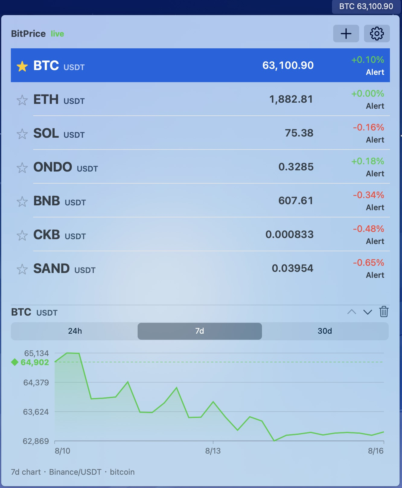
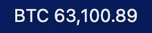
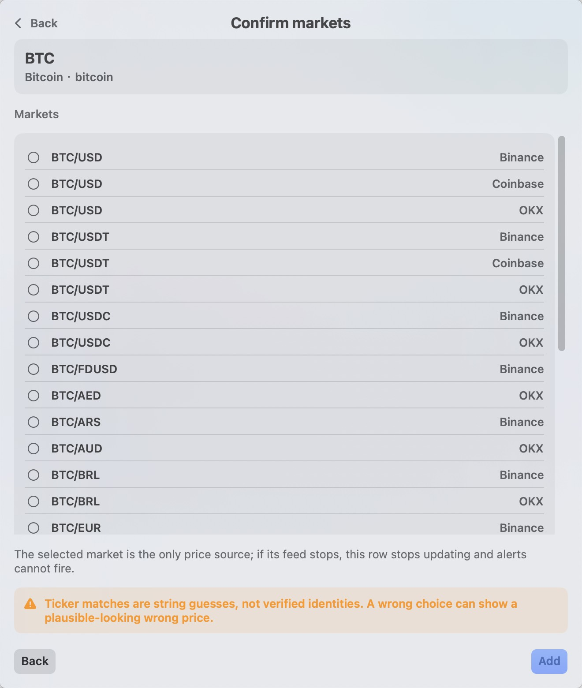
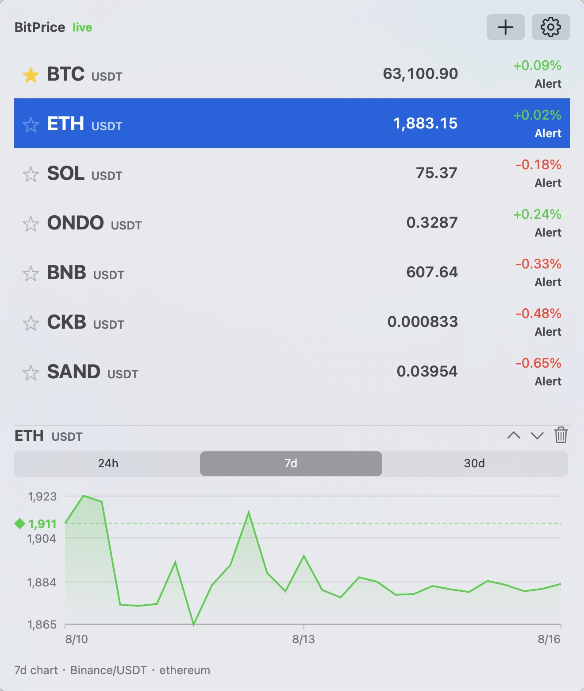
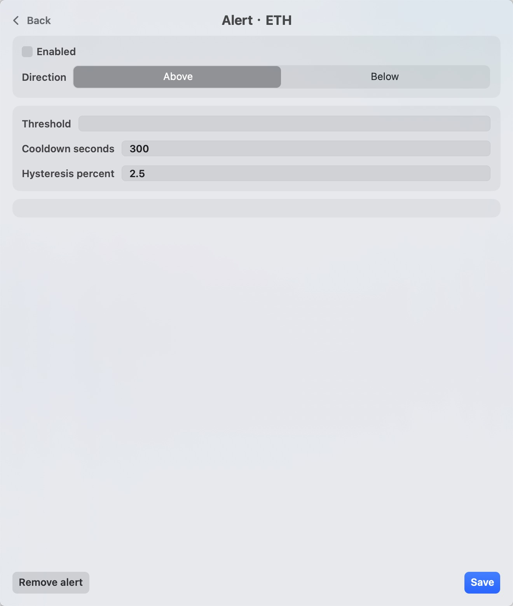
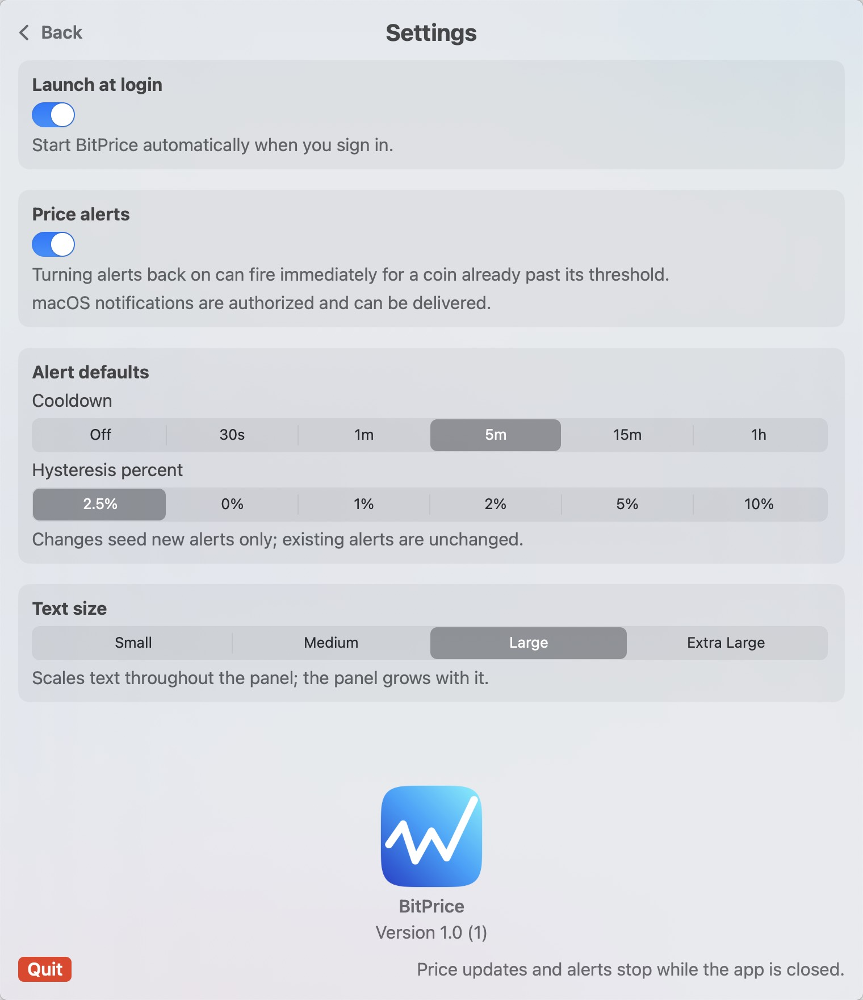

# BitPrice

A macOS menu bar app that shows one cryptocurrency price in the menu bar and the rest of your watchlist in a panel behind it.



Prices arrive over live WebSocket feeds from Binance and OKX, and over a 60-second poll from Coinbase. You pick the exact market for each coin — there is no automatic ticker matching, because ticker symbols are not unique. Price alerts fire as macOS notifications while the app is running.

No accounts, no telemetry, no third-party dependencies. macOS 14.0 or later, Apple silicon.

## Install

**Requires an Apple silicon Mac running macOS 14.0 or later.** The build targets `arm64` only, so it will not run on an Intel Mac.

### Download

Take the latest `BitPrice-<version>.zip` from the [Releases page](../../releases), expand it, and move `BitPrice.app` into `/Applications`.

Then clear the quarantine attribute:

```bash
xattr -dr com.apple.quarantine /Applications/BitPrice.app
```

**This step is required, and skipping it produces a misleading error.** macOS will say the app "is damaged and can't be opened" and offer to move it to the Trash. The app is not damaged. BitPrice is signed ad-hoc rather than with a paid Apple Developer ID, so it is not notarized, and macOS refuses anything downloaded that it cannot check with Apple. The command above removes the quarantine flag that triggers the refusal.

If you would rather not run that command, build from source instead — locally built copies are never quarantined.

### Build from source

```bash
git clone <this repo>
cd BitPrice
bash scripts/build-app.sh
open build/BitPrice.app
```

The build needs the Xcode command line tools (`xcode-select --install`) and takes well under a minute. It compiles with Swift 6 in strict concurrency mode and treats warnings as errors, so a successful build is a clean one.

To keep it around, drag `build/BitPrice.app` into `/Applications` or `~/Applications`.

## Using it

### Starting

BitPrice has no Dock icon and no window — `LSUIElement` is set, so it lives entirely in the menu bar. After launching, look for it at the top right of the screen. It shows `BitPrice` until you have a coin with a price, then switches to that coin's symbol and price.

Click the menu bar label to open the panel. Click anywhere else to dismiss it.

Only one copy runs at a time.



Next to the app's name in the panel header is a status word: **live**, **stale**, or **offline**, summarising the health of the feeds behind your watchlist.

### Adding a coin

Press the **+** button in the panel header.

1. **Search** by name or symbol. Results come from a coin catalogue, and each result shows the project name and its identifier.
2. **Pick the market.** This is the step that matters. Selecting a search result identifies the *project*, not the market — several unrelated coins can share one ticker, and wrapped or bridged assets share tickers with the originals. So the app shows every candidate market it found across Binance, Coinbase, and OKX, and you choose exactly one.
3. Press **Add**.

The market you choose is that coin's only price source. The confirmation screen says so directly: if that feed stops, the row stops updating and its alerts cannot fire. It also warns that ticker matches are string guesses rather than verified identities, so a wrong choice can show a plausible-looking wrong price. Choosing a Coinbase market adds that a 60-second poll can miss a brief alert breach a live feed would have caught.

Quote assets are not restricted to USDT. The candidate list carries every quote the venues offer for that ticker — USD, USDT, USDC, FDUSD, and national currencies such as EUR, AUD, BRL, and ARS — each labelled with the venue supplying it.

The watchlist holds up to 25 coins. The first launch seeds Bitcoin.



### Choosing what shows in the menu bar

Each row has a star on its left. Click it to make that coin the **primary** — the one whose symbol and price appear in the menu bar itself. The star fills yellow on the current primary.

The label reads as `SYMBOL price`, for example `BTC 67,432.10`. Prices show two decimals at or above 1 and up to six below it, so small-denomination coins stay legible.

If the watchlist is empty, or the primary has no price yet, the label falls back to `BitPrice`.

Deleting the primary promotes the first remaining coin.

### Reading a row

A row shows the coin's symbol and quote asset, its latest price, and its 24-hour change — green when up, red when down. A dash means the value is not available yet. Below the change is an **Alert** link that opens that coin's alert editor; it reads `Alert · Off`, struck through, while alerts are globally disabled.

Selecting a row opens a chart beneath the list, over **24h**, **7d**, or **30d**. The chart is drawn from the same venue that supplies the row's price, and a caption underneath names it — for example `7d chart · Binance/USDT · ethereum`. A diamond on the left edge marks the series' opening close, with a dashed line across the chart at that level, so you can see at a glance whether the range closed up or down. If a refresh fails, the chart keeps showing the last data it had and says so rather than going blank.

Rows dim when their source is offline.

The controls above the chart reorder the selected coin or remove it.



### Price alerts

Open a row's alert editor to set one alert per coin.

- **Direction and threshold** — fire when the price goes **Above** or **Below** a price you set.
- **Cooldown** — the minimum time before the same alert can fire again.
- **Hysteresis percent** — how far the price must retreat past the threshold before the alert re-arms. At 0 the alert re-arms as soon as the price crosses back, and the cooldown alone limits repeats.

After firing, an alert disarms and waits for the re-arm price; the editor tells you when it is in that state.

Two things to know:

- **Alerts stop when the app is closed.** So do price updates. Nothing runs in the background — the Settings screen repeats this under the Quit button.
- **Alerts have a global switch.** Turning them off silences every alert. Turning them back on can fire immediately for a coin already past its threshold, which is the intended behaviour and is warned about in Settings.

Alerts on a Coinbase-sourced coin inherit the 60-second poll's blind spot: a breach that begins and ends between two polls is not seen.



### Settings

The gear button in the panel header opens Settings.

| Setting | What it does |
|---|---|
| Launch at login | Starts BitPrice when you sign in |
| Price alerts | Global on/off for every alert; also reports whether macOS notifications are authorised |
| Alert defaults | Cooldown (Off, 30s, 1m, 5m, 15m, 1h) and hysteresis (0%, 1%, 2%, 2.5%, 5%, 10%) seeded into *new* alerts; existing alerts are unchanged |
| Text size | Small, Medium, Large, or Extra Large |

The alerts section tells you directly whether macOS will deliver notifications. If authorisation was refused, alerts still fire and are recorded, but the system will not show a banner.

Text size scales everything in the panel, and the panel widens with it — so a larger size does not squeeze the columns.

**Quit** is at the bottom left of Settings, below the version number.



## Development

```bash
bash scripts/run-tests.sh    # acceptance tests
bash scripts/build-app.sh    # build and sign the app bundle
bash scripts/release.sh 1.1  # test, build, and package a release archive
```

`release.sh` packages only — it does not tag or publish. It refuses to run on a dirty tree or when the version argument disagrees with `Info.plist`, packages with `ditto` so the code signature survives, and verifies the signature by expanding the archive it just wrote rather than by trusting the build directory.

The tests are a plain executable with an array of named cases, not XCTest. Two cases skip when run without an Aqua session; that is expected on a headless run.

Source is in [Sources/BitPrice/](Sources/BitPrice/). The current behavioural contract is [docs/SPEC.md](docs/SPEC.md) — it is kept in step with the implementation and is the right place to look before changing anything.

Superseded design documents are in [docs/history/](docs/history/). They record how the app got here, including several rounds of adversarial review, but they describe architectures the code has since replaced. Do not treat them as current.

## Limits

- Apple silicon only; the build targets `arm64-apple-macosx14.0`.
- One market per coin. There is no failover to a second venue if that market's feed goes quiet.
- Coinbase-sourced coins update every 60 seconds rather than continuously.
- Up to 25 coins.
- The app is signed ad-hoc, so first launch may need a right-click → Open.
